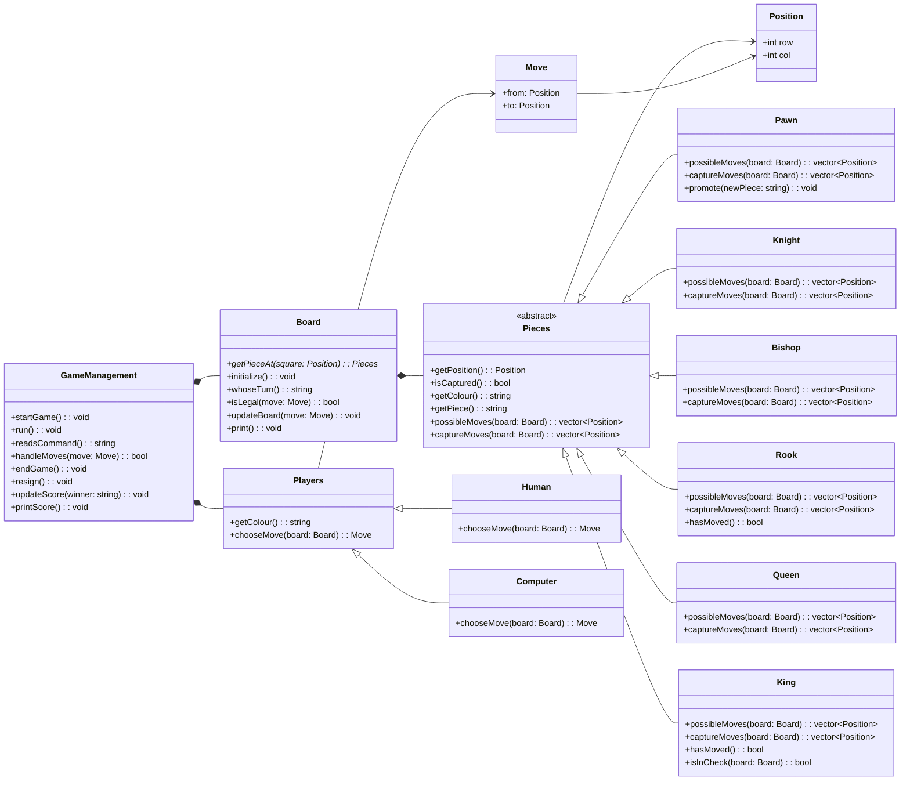

# Design
### UML

### Explanation
**Arrows**
- Hollow arrow: inheritance (points to base class)
- Pointy arrow: A class uses another class
- Diamond arrow: has-a relationship (points to owning class)

**Position** and **Move** are simple class/struct used as data members in other classes. Move also holds Position as a data member.

**Pieces** is an abstract base class, and the different types of actual chess pieces inherit this abstract class. Each subclass implements their own possibleMoves() and captureMoves(), according to the rule for each piece.
- Pawn has an additional promote() function for the Promotion rule. En Passant will be handle in Pawn's captureMoves().
- Rook and King has an additional hasMove() function to check castling availability. The castling move itself will be handled in their possibleMoves().
- King has an additional isInCheck() function.

**Board** oversees the movement of pieces during one game. It performs additional validation on moves (i.e., a move that is considered fine by an individual piece, but is illegal in the game as it doesn't resolve a check on their own king/puts oneself in check), moves the pieces, updates the board, and prints the board.

**Players** is an abstract base class for Human and Computer. Each subclass implements their own chooseMove(). For Human, it simply takes input. For Computer, there will be an established move algorithm for each level.

**GameManagement** oversees the entire session, since one session can have multiple chess games. It starts & ends the game and records the score.

# Answers to Questions
Q1: Chess programs usually come with a book of standard opening move sequences, which list
accepted opening moves and responses to opponents’ moves, for the first dozen or so moves of the game.
Although you are not required to support this, discuss how you would implement a book of standard openings
if required.

Q2: How would you implement a feature that would allow a player to undo his/her last move? What
about an unlimited number of undos?

Q3: Variations on chess abound. For example, four-handed chess is a variant that is played by
four players (search for it!). Outline the changes that would be necessary to make your program into a
four-handed chess game.

# Breakdown
**Official Deadline 1: Nov 17th, 17:00**
Task Distribution
- Isaac: breakdown, revise final doc
- Jayden: Answer to questions
- Gyungbin: UML, Design

**Official Deadline 2: Dec 1st, 17:00**

Task Distribution
- Isaac: implement Player classes, contribute to Pieces subclasses, Board class 
- Jayden: implement Game Management class, contribute to Pieces subclasses, Board class 
- Gyungbin: implement skeleton code, Base class Pieces, contribute to Pieces subclasses, Board class 

Estimated dates
- Nov 19th: complete skeleton code (function headers), main.cpp
- Nov 24th: complete implementation on Pieces subclasses
- Nov 29th: complete implementation on Board, Players (computer level 1-3), GameMode
- Dec 1: Implement additional functions, review for bugs.