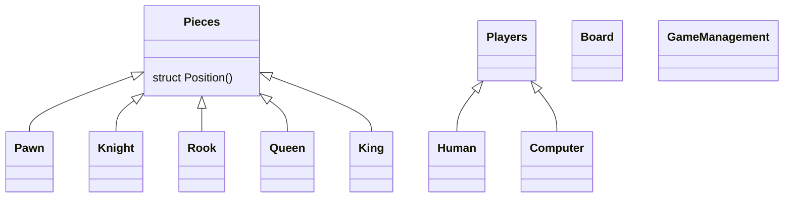

# Breakdown

# UML

# Design

# Answers to Questions
Q1: Chess programs usually come with a book of standard opening move sequences, which list
accepted opening moves and responses to opponents’ moves, for the first dozen or so moves of the game.
Although you are not required to support this, discuss how you would implement a book of standard openings
if required.

Q2: How would you implement a feature that would allow a player to undo his/her last move? What
about an unlimited number of undos?

Q3: Variations on chess abound. For example, four-handed chess is a variant that is played by
four players (search for it!). Outline the changes that would be necessary to make your program into a
four-handed chess game.

# Estimated completion dates
Official Deadline 1: Nov 17th, 17:00
- Isaac: breakdown, revise final doc
- Jayden: Answer to questions
- Gyungbin: UML, Design

Official Deadline 2: Dec 1st, 17:00
- Isaac: implement Player classes, contribute to Pieces subclasses, Board class 
- Jayden: implement Game Management class, contribute to Pieces subclasses, Board class 
- Gyungbin: implement skeleton code, Base class Pieces, contribute to Pieces subclasses, Board class 

    Estimated dates
    
    - Nov 19th: complete skeleton code (function headers), main.cpp
    - Nov 24th: complete implementation on Pieces subclasses
    - Nov 29th: complete implementation on Board, Players (computer level 1-3), GameMode
    - Dec 1: Implement additional functions, review for bugs.