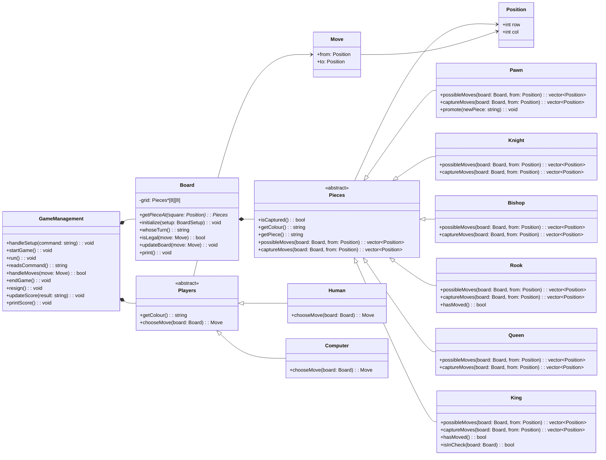

# Design
### UML

### Explanation
**Arrows**
- Hollow arrow: inheritance (points to base class)
- Pointy arrow: A class uses another class
- Diamond arrow: has-a relationship (points to owning class)

**Position** and **Move** are simple class/struct used as data members in other classes. Move also holds Position as a data member.

**Pieces** is an abstract base class, and the different types of actual chess pieces inherit this abstract class. Each subclass implements their own possibleMoves() and captureMoves(), according to the rule for each piece.
- Pawn has an additional promote() function for the Promotion rule. En Passant will be handle in Pawn's captureMoves().
- Rook and King has an additional hasMove() function to check castling availability. The castling move itself will be handled in their possibleMoves().
- King has an additional isInCheck() function.

**Board** oversees the movement of pieces during one game. It performs additional validation on moves (i.e., a move that is considered fine by an individual piece, but is illegal in the game as it doesn't resolve a check on their own king/puts oneself in check), moves the pieces, updates the board, and prints the board.

**Players** is an abstract base class for Human and Computer. Each subclass implements their own chooseMove(). For Human, it simply takes input. For Computer, there will be an established move algorithm for each level.

**GameManagement** oversees the entire session, since one session can have multiple chess games. It starts & ends the game and records the score.

# Answers to Questions
Q1: Chess programs usually come with a book of standard opening move sequences, which list
accepted opening moves and responses to opponents’ moves, for the first dozen or so moves of the game.
Although you are not required to support this, discuss how you would implement a book of standard openings
if required.

To allow the computer to play standard openings, we would create an Opening class that reads opening move sequences from a file.
We would also need to add a move history tracker by storing a linked list of move records in GameManagement. Each node would contain the player’s colour, 
piece type, starting position, destination position, and promotion choice if applicable. After each successful move, we would append a node to the end of list. 

The Opening class would read this list in order to compare it with stored opening sequences. The history would reset when a new game starts.
By comparing the current game’s move history with the stored sequences. If the history matches the beginning of an opening, this Class will return the next possible move. 
Computer would receive a suggested move from the Opening class and call Board’s IsLegal() function to confirm that it follows the rules and does not leave its own king in check before sending to Board.
If the opponent deviates from the stored sequences, the sequence ends, or no suggested move is legal, Computer would fall back to its set difficulty based move selection.
Keeping opening sequences in a separate file would allow us to add openings without changing the move-selection code. We would also be able to use this class for higher difficulty levels, 
while levels 1 and 2 would continue using their existing move-selection strategies.
Note, this will only work during default position and not if user used a custom setup. Custom setup will defult to set difficulty move selection. 

Q2: How would you implement a feature that would allow a player to undo his/her last move? What
about an unlimited number of undos?

We would implement undo using a linked list of move records stored in GameManagement as described from the question above. 
We would add an undoMove() function to GameManagement. It would remove the last node from the list, reset Board to the saved initial configuration, and replay the remaining moves in order. 
Replaying would reconstruct the position, including captured pieces, promotions, castling, en passant, and whose turn it is, without adding duplicate history records or updating scores.

To support one undo, we will only allow this operation after a new played move. To support unlimited undos, we would allow repeated calls until the list is empty.
If the linked list is empty, the function would leave the board unchanged and report an error that there are no moves to undo.

Q3: Variations on chess abound. For example, four-handed chess is a variant that is played by
four players (search for it!). Outline the changes that would be necessary to make your program into a
four-handed chess game.

To support four-handed chess, the Board class would need a larger grid and a way to identify squares outside the playable area as grid is not a square. 
initialize() would place four sets of pieces, and print() would display the larger board and distinguish all four players.
Pieces and Players would support four player colours instead of only white and black. Most pieces could retain their existing movement patterns, but their movement functions would be fitted to new board.

GameManagement will need to be able to store four players, and cycle through turns. This includes resignation, elimination, scoring, and ending the game. 
Additionally, move valdations and checks will now need to check attacks from all players. Checkmates and stalmates will only eliminate one player and not instantly end the game. 
Lastly, setup commands and validation would also be extended to handle four colours, four kings, and the new starting positions.

# Breakdown
**Official Deadline 1: Nov 17th, 17:00**
Task Distribution
- Isaac: breakdown, revise final doc
- Jayden: Answer to questions
- Gyungbin: UML, Design

**Official Deadline 2: Dec 1st, 17:00**

Task Distribution
- Isaac: implement Player classes, contribute to Pieces subclasses, Board class 
- Jayden: implement Game Management class, contribute to Pieces subclasses, Board class 
- Gyungbin: implement skeleton code, Base class Pieces, contribute to Pieces subclasses, Board class 

Estimated dates
- Nov 19th: complete skeleton code (function headers), main.cpp
- Nov 24th: complete implementation on Pieces subclasses
- Nov 29th: complete implementation on Board, Players (computer level 1-3), GameMode
- Dec 1: Implement additional functions, review for bugs.