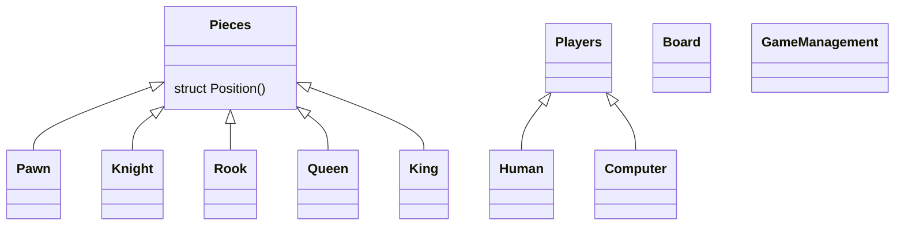

# Breakdown

# UML

# Design

# Answers to Questions
Q1: Chess programs usually come with a book of standard opening move sequences, which list
accepted opening moves and responses to opponents’ moves, for the first dozen or so moves of the game.
Although you are not required to support this, discuss how you would implement a book of standard openings
if required.

To allow the computer to play standard openings, we would create an Opening class that reads opening move sequences from a file.
We would also need to add a move history tracker by storing a linked list of move records in GameManagement. Each node would contain the player’s colour, 
piece type, starting position, destination position, and promotion choice if applicable. After each move, we would append a node to the end of list. 

The Opening class would read this list in order to compare it with stored opening sequences. The history would reset when a new game starts.
By comparing the current game’s move history with the stored sequences. If the history matches the beginning of an opening, this Class will return the next possible move. 
Computer would receive a suggested move from the Opening class and call Board’s IsLegal() function to confirm that it follows the rules and does not leave its own king in check before sending to Board.
If the opponent deviates from the stored sequences, the sequence ends, or no suggested move is legal, Computer would fall back to its set difficulty based move selection.
Keeping opening sequences in a separate file would allow us to add openings without changing the move-selection code. We would also be able to use this class for higher difficulty levels, 
while levels 1 and 2 would continue using their existing move-selection strategies.
Note, this will only work during defult position and not if user used a custom setup. Custom setup will defult to set difficulty move selection. 

Q2: How would you implement a feature that would allow a player to undo his/her last move? What
about an unlimited number of undos?

We would implement undo using a linked list of move records stored in GameManagement. Each node would contain the player’s colour, piece type, starting position, destination position, 
and promotion choice if applicable. After each successful move, we would append a node to the list.

We would also save the initial board configuration, this will help save custom setups. 
...

Q3: Variations on chess abound. For example, four-handed chess is a variant that is played by
four players (search for it!). Outline the changes that would be necessary to make your program into a
four-handed chess game.

# Estimated completion dates
Official Deadline 1: Nov 17th, 17:00
- Isaac: breakdown, revise final doc
- Jayden: Answer to questions
- Gyungbin: UML, Design

Official Deadline 2: Dec 1st, 17:00
- Isaac: implement Player classes, contribute to Pieces subclasses, Board class 
- Jayden: implement Game Management class, contribute to Pieces subclasses, Board class 
- Gyungbin: implement skeleton code, Base class Pieces, contribute to Pieces subclasses, Board class 

    Estimated dates
    
    - Nov 19th: complete skeleton code (function headers), main.cpp
    - Nov 24th: complete implementation on Pieces subclasses
    - Nov 29th: complete implementation on Board, Players (computer level 1-3), GameMode
    - Dec 1: Implement additional functions, review for bugs.